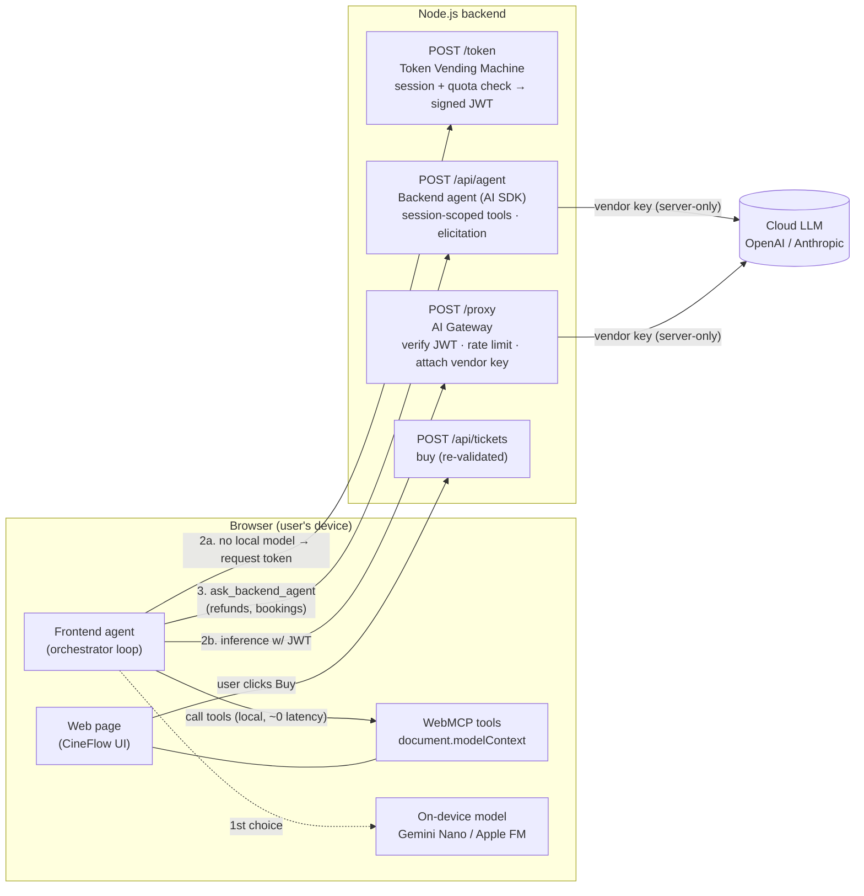
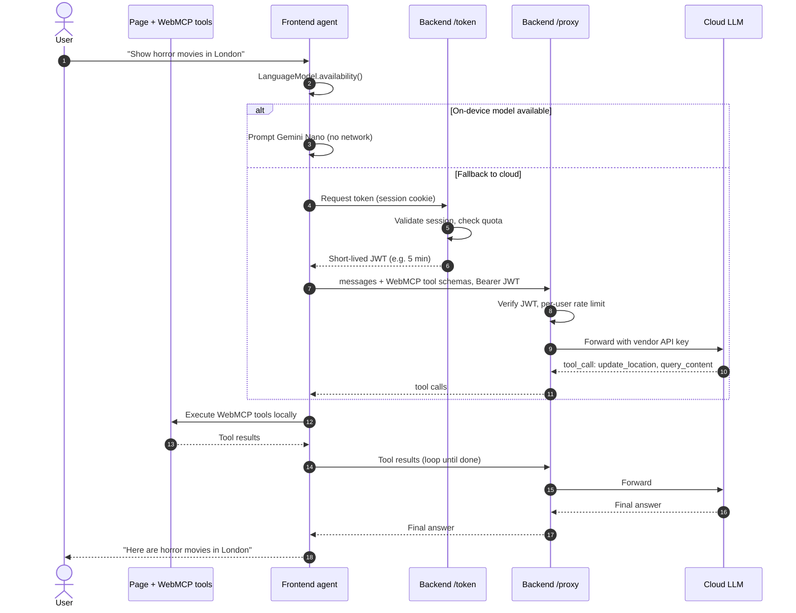
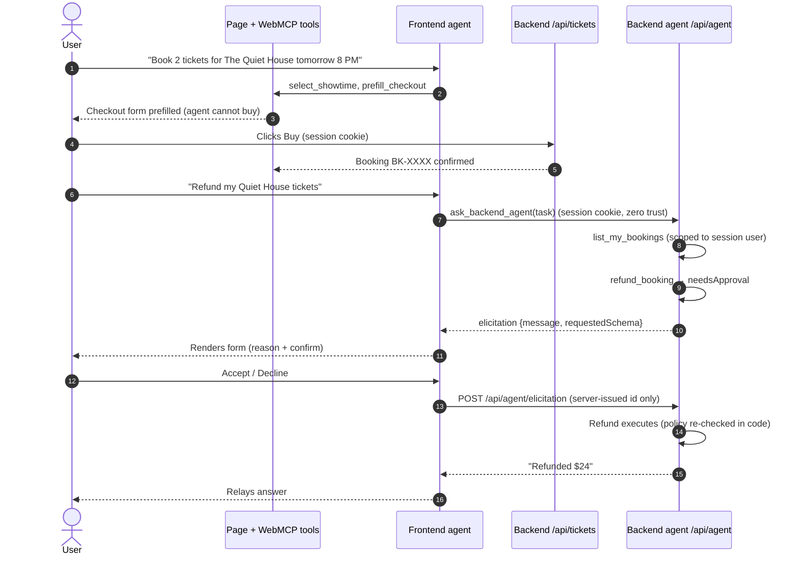

# Architecture: Frontend Agent + Token Vending Machine

See [ADR 0001](adr/0001-frontend-agent-with-token-vending-machine.md) for the decision record.

## Components

## End-to-end flow (cloud fallback path)

**Key property:** the vendor API key never leaves the backend; the browser only ever holds a short-lived, user-bound, rate-limited JWT.

## Purchase and refund (delegation + elicitation)

